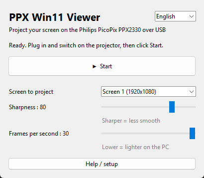

# PPX Win11 Viewer

**Project your Windows 10/11 screen on a Philips PicoPix PPX2330 over USB.**
The official *Picopix Fun Viewer* relies on Windows XP-era display drivers that Windows 8 and later refuse to load (Device Manager error code 37). PPX Win11 Viewer replaces it with a small, driver-free app.

> Unofficial project, not affiliated with or endorsed by Philips, Sagemcom or Screeneo. "Philips" and "PicoPix" are trademarks of their respective owners.



## Features
- One-click Start / Stop, automatic switch of the projector from storage mode to display mode
- Live sharpness and frame rate sliders, multi-monitor support
- Sends frames at the projector's native resolution (640×360), aspect ratio preserved
- 9 languages: English, Français, Español, Deutsch, Italiano, Português, Русский, 中文, 日本語
- Single portable `.exe`, nothing to install

## Compatibility
| Projector | Status |
|---|---|
| PicoPix PPX2330 | ✅ Tested (Windows 11) |
| PicoPix PPX2340 | ❓ Same USB IDs, should work, untested — please report |
| Other PicoPix models | ❓ Unknown — please open an issue |

## Download & setup
1. Download `PPX-Win11-Viewer.zip` from the [Releases](../../releases) page and unzip it.
2. **One-time driver setup** with the free tool [Zadig](https://zadig.akeo.ie) (also explained in the app's *Help / setup* button):
   1. Switch on the projector with the USB cable plugged in and wait for the "PC connection" screen.
   2. Zadig → *Options* → *List All Devices* → **PicoPix2330** (USB ID `1DE1 1101`) → **WinUSB** → *Replace Driver*.
   3. Run **PPX Win11 Viewer.exe** and click *Start*: the projector switches to display mode (a driver error then shows, that's expected).
   4. Zadig → **actions-subdisplay** (USB ID `21E7 0019`) → **WinUSB** → *Replace Driver*.
   5. Click *Start* again. Your screen appears on the projector.
3. Next times: switch on the projector, wait for "PC connection", click *Start*.

### Good to know
- **SmartScreen / antivirus:** the `.exe` is not code-signed and is built with PyInstaller, so Windows may show "Windows protected your PC" (*More info* → *Run anyway*). Check the SHA-256 published with each release, or build it yourself (see below).
- **Projector files:** with WinUSB on the storage mode, Windows Explorer no longer shows the projector's files. To undo: Device Manager → *PicoPix2330* → *Uninstall device* (tick *delete the driver*), then replug.
- **Projector frozen:** switch it off for 10 seconds with the side switch, back on, then *Start*.
- **Readability:** the projector is 640×360; enlarge Windows text (*Settings → Display → Scale*) or set the screen to 1280×720.
- **Brightness:** turn off *Power Save* in the projector settings; it also dims itself when hot.
- Picture only, no audio over USB.

## Run from source / build
Requires Python 3.10+ on Windows.
```
pip install -r requirements.txt
python picopix_gui.py              # GUI
python picopix.py --help           # command-line version
python picopix.py --selftest       # protocol and translation self-check
```
Build the portable executable:
```
pip install pyinstaller
python -m PyInstaller --onefile --windowed --name "PPX Win11 Viewer" --collect-all libusb_package picopix_gui.py
```

## How it works
- The projector first enumerates as USB mass storage (`1DE1:1101`). A vendor SCSI command (`FF 02`, sent as a raw 31-byte Bulk-Only CBW) makes it re-enumerate as a display device (`21E7:0019`). The PPX2330 ignores the 32-byte variant used by libam7xxx's `am7xxx-modeswitch`.
- After switching, wait ~8 s for the Philips logo to finish; commands sent earlier freeze the device.
- Then: a `DEVINFO` request (returns native resolution), followed by JPEG frames, each preceded by a 24-byte header, over bulk endpoint `0x01`.
- Screen capture: [mss](https://github.com/BoboTiG/python-mss); USB: [pyusb](https://github.com/pyusb/pyusb) + [libusb](https://libusb.info).

## Credits
USB protocol documented by the [libam7xxx](https://git.ao2.it/libam7xxx.git) project by Antonio Ospite.

## License
[GPL-3.0](LICENSE). Provided as is, without warranty.

---

## 🇫🇷 En français
**Projetez l'écran de Windows 10/11 sur un Philips PicoPix PPX2330 en USB.** Le logiciel officiel *Picopix Fun Viewer* ne fonctionne plus depuis Windows 8 : PPX Win11 Viewer le remplace.

1. Téléchargez `PPX-Win11-Viewer.zip` dans [Releases](../../releases) et dézippez-le.
2. Une seule fois, installez le pilote **WinUSB** avec [Zadig](https://zadig.akeo.ie) sur **PicoPix2330**, cliquez sur *Démarrer*, puis faites de même sur **actions-subdisplay**. Les étapes détaillées sont dans le bouton *Aide / installation* de l'appli et dans le fichier `LISEZMOI - README.txt`.
3. Ensuite : allumez le projecteur, attendez « Connexion au PC », cliquez sur *Démarrer*.

Projet non officiel, sans lien avec Philips ou Sagemcom.
